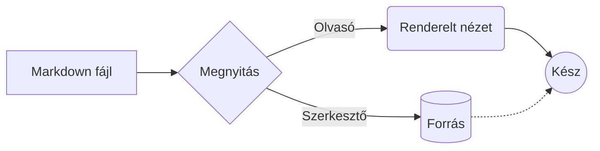
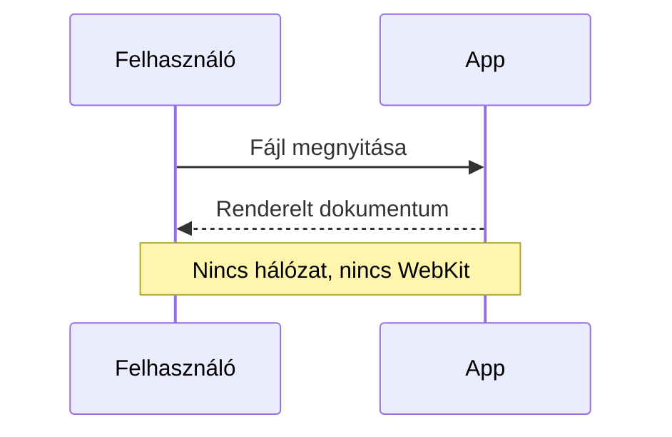
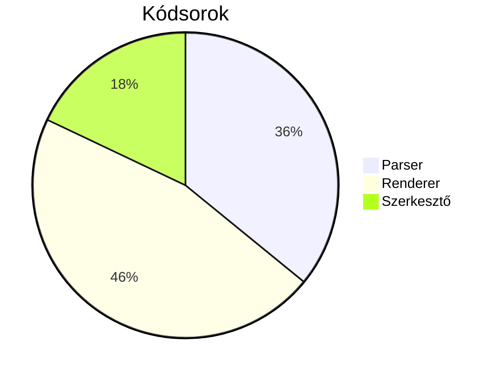

# Bővítmények – bemutató

Lábjegyzet a mondat végén.[^elso] Még egy hivatkozás[^masodik], és újra az első.[^elso]
Emoji rövidkódok: :tada: :rocket: :+1: :white_check_mark: :warning: :hungary: :hu: :sunflower:

## Matematika

Inline képlet: $E = mc^2$, a $\sqrt{a^2 + b^2}$ átfogó, és a $\alpha_i^{(k)}$ index. Ár: $5 és $10 (nem képlet).

$$
\int_0^\infty e^{-x^2}\,dx = \frac{\sqrt{\pi}}{2}
$$

$$\sum_{n=1}^{\infty} \frac{1}{n^2} = \frac{\pi^2}{6} \qquad \lim_{x \to 0} \frac{\sin x}{x} = 1$$

```math
\mathbf{A} = \begin{pmatrix} a_{11} & a_{12} \\ a_{21} & a_{22} \end{pmatrix}, \quad
f(x) = \begin{cases} x^2 & x \ge 0 \\ -x & x < 0 \end{cases}
```

$$\left( \frac{a}{b} \right)^{n} \ne \overline{z} + \hat{x} + \vec{v} \in \mathbb{R}^3,\; \forall \varepsilon > 0$$

## Mermaid







```mermaid
gantt
    title Nem támogatott típus
```

## Definíciós lista

Markdown
:   Egyszerű jelölőnyelv szöveges dokumentumokhoz.

TeX
:   Matematikai szedőrendszer.
:   Második definíció ugyanahhoz a kifejezéshez.

## Részletek

<details>
<summary>Kattints a kinyitáshoz</summary>

Rejtett **Markdown** tartalom, listával:

- egy
- kettő

</details>

<details open>
<summary>Alapból nyitva</summary>

Ez látszik.

</details>

## HTML és CSS

<p style="text-align: center; color: #c0392b">Középre igazított, piros bekezdés.</p>

Inline: <span style="color: teal; font-weight: bold">türkiz félkövér</span>,
<span style="background-color: yellow">kiemelt háttér</span>, <font color="purple">lila font</font>,
<span style="font-size: 120%">nagyobb</span>.

<table>
  <tr><th>Termék</th><th colspan="2">Adatok</th></tr>
  <tr><td>Fúró</td><td align="right">1</td><td>24 990 Ft</td></tr>
  <tr><td>Tinta</td><td align="right">12</td><td>450 Ft</td></tr>
</table>

## Széles tartalom (vízszintes görgetés)

```python
def very_long_function_name(argument_one, argument_two, argument_three, argument_four, argument_five, argument_six):
    return {"result": argument_one + argument_two, "items": [argument_three, argument_four, argument_five, argument_six]}  # comment
```

| Oszlop 1 | Oszlop 2 | Oszlop 3 | Oszlop 4 | Oszlop 5 | Oszlop 6 | Oszlop 7 | Oszlop 8 | Oszlop 9 | Oszlop 10 |
|---|---|---|---|---|---|---|---|---|---|
| hosszabb_érték_1 | hosszabb_érték_2 | hosszabb_érték_3 | hosszabb_érték_4 | hosszabb_érték_5 | hosszabb_érték_6 | hosszabb_érték_7 | hosszabb_érték_8 | hosszabb_érték_9 | hosszabb_érték_10 |

## Kódkiemelés

```javascript
// Komment
const greet = (name) => `Szia, ${name}!`;
export default async function main() { return await fetch("https://example.com", { method: "GET" }); }
```

```json
{ "name": "md-reader", "version": 2, "private": true, "tags": ["markdown", null] }
```

```diff
- régi sor
+ új sor
@@ -1,2 +1,2 @@
```

## Feladatlista (kattintható)

- [ ] Kattints a négyzetre
- [x] Ez már kész

## Távoli kép


[^elso]: Az első lábjegyzet szövege, **formázással**.
[^masodik]: A második lábjegyzet.
